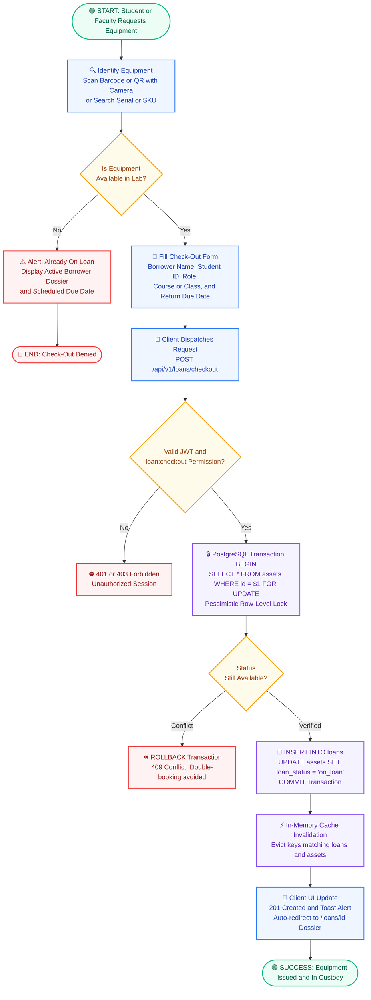
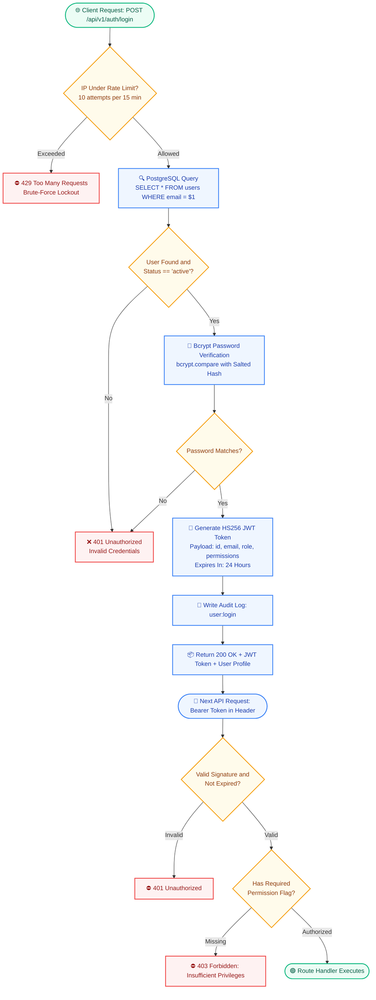
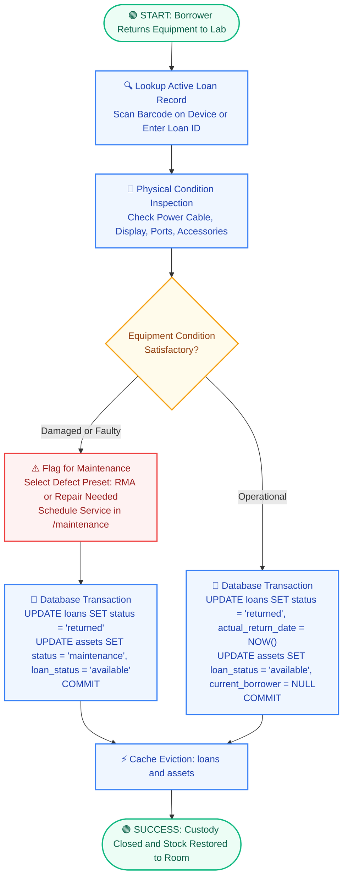
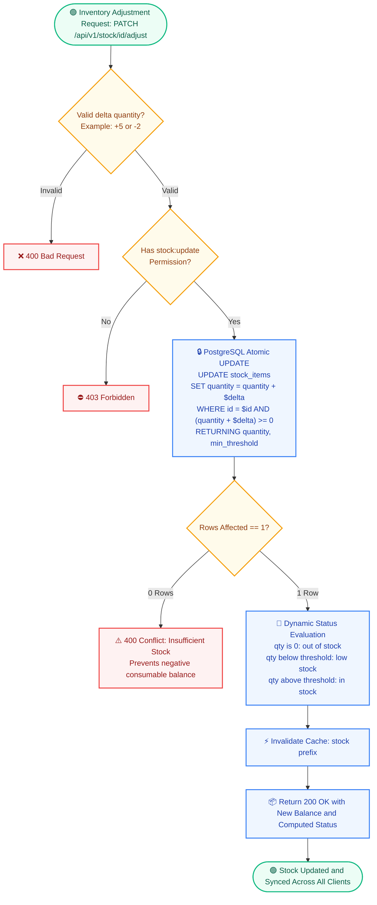
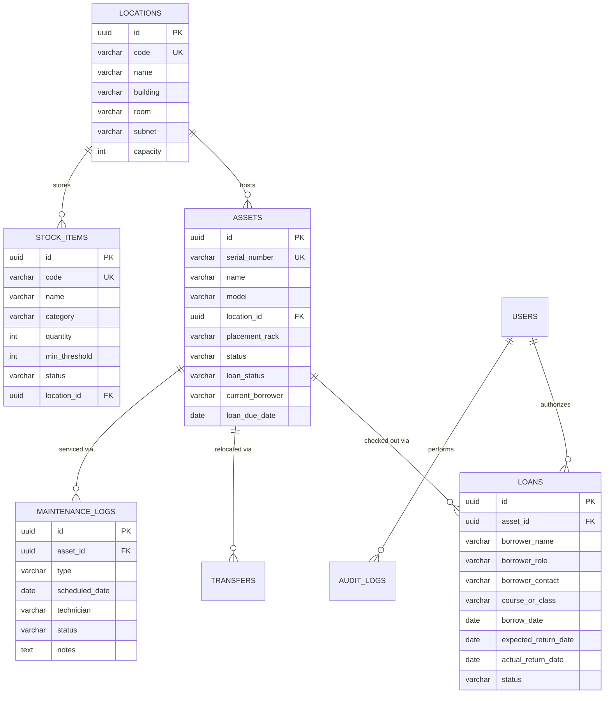

# 📊 CSD LabStock: System Architecture & Workflow Diagrams

> **Visual flowcharts and entity relationships for the CSD LabStock Platform.**
> This directory contains native Draw.io XML files (`.drawio`) for local IDE editing, along with interactive GitHub-rendered Mermaid diagrams displayed below.

---

## 📑 Diagram Directory

| Diagram | Description | Native Editor File |
| :--- | :--- | :--- |
| 🤝 **Equipment Check-Out Workflow** | Concurrency-safe lending, barcode lookup, ACID row-level locking, and cache eviction | [`checkout-workflow.drawio`](./checkout-workflow.drawio) |
| 🔐 **Authentication & RBAC Security** | Rate limiting, Bcrypt password hashing, HS256 JWT tokens, and RBAC middleware | [`auth-workflow.drawio`](./auth-workflow.drawio) |
| 🔄 **Equipment Return & Inspection** | Check-in procedure, physical inspection checklist, defect routing, and status restoration | [`return-workflow.drawio`](./return-workflow.drawio) |
| 📦 **Atomic Stock Adjustment** | Non-negative inventory enforcement, single-query atomic updates, and low-stock alerts | [`stock-workflow.drawio`](./stock-workflow.drawio) |
| 🗄️ **Relational Database ERD** | Complete PostgreSQL database schema with primary and foreign key constraints | [`database-erd.drawio`](./database-erd.drawio) • [`schema.dbml`](./schema.dbml) |

---

## 1. 🤝 Concurrency-Safe Equipment Check-Out & Lending Workflow

---

## 2. 🔐 Authentication, JWT & RBAC Security Workflow

---

## 3. 🔄 Equipment Check-In & Physical Return Inspection

---

## 4. 📦 Atomic Consumables Stock Adjustment

---

## 5. 🗄️ Relational Database Schema (ERD)

---

## 🛠️ Editing Diagrams

1. **In VS Code / Antigravity**: Open any `.drawio` file directly with the **Draw.io Integration** extension.
2. **In Browser**: Navigate to **[app.diagrams.net](https://app.diagrams.net)** and drag-and-drop any `.drawio` file into the canvas.
3. **Database DBML**: Open [`schema.dbml`](./schema.dbml) in **[dbdiagram.io](https://dbdiagram.io)** for interactive relational inspection.
